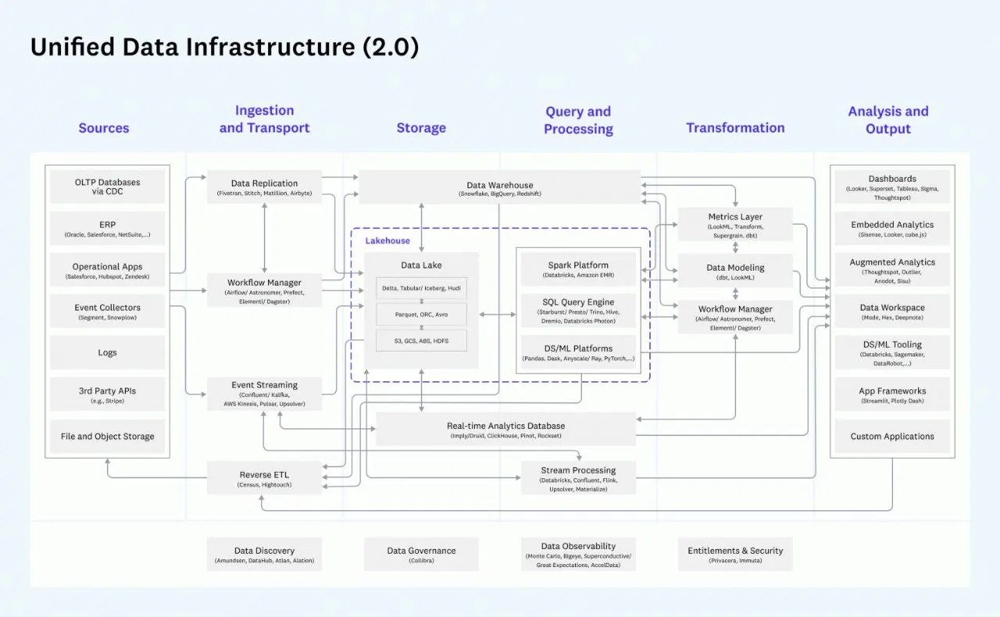

# Data Platform in a Box



> Картинка выше — reference architecture, не буквальная схема текущего compose-стенда.


Локальная DWH/BI платформа в Docker Compose — единый стек для аналитики
и фундамент для AI/DevOps-проектов. Реальные данные (HH.ru и «Работа России»),
медальонная архитектура bronze → silver → gold, полный мониторинг,
автоматический ELT-конвейер.

Подробный план: [PROJECT_PLAN.md](./PROJECT_PLAN.md).

---

## Текущий статус

**Шаг 5: ELT-конвейер и технический мониторинг готовы** ✅

| Слой | Что сделано |
|---|---|
| Инфраструктура | PostgreSQL 16 + ClickHouse 24 + Redis 7 + StatsD-exporter |
| Мониторинг | Prometheus + Grafana + Alertmanager + node-exporter + cAdvisor + postgres-exporter; дашборды Overview, ClickHouse Health и Airflow Health |
| Оркестрация | Airflow 3.x с CeleryExecutor (6 контейнеров) |
| Ingest (E+L) | DAG `hh_vacancies_snapshot`: HH.ru → `bronze_hh_vacancies`; DAG `trudvsem_vacancies_snapshot`: «Работа России» → `bronze_trudvsem_vacancies` |
| Transform (T) | DAG `dbt_hh_transform`: HH + «Работа России» → staging/silver → unified silver → gold |
| Медальонный DWH | Три базы ClickHouse: `dpib` / `dpib_silver` / `dpib_gold` |
| Метрики | Airflow через StatsD → Prometheus; ClickHouse через встроенный `:9363` |
| CI | GitHub Actions: статический lint (~25 сек) |

Следующее: Superset — аналитические дашборды поверх Gold-витрин. Grafana остаётся только для технического мониторинга.

---

## Как это работает

### ELT-цепочка

```
HH.ru (каждые 4 часа, cron: 0 */4 * * *)
    │
    ▼  hh_vacancies_snapshot
    ├── make_snapshot_id        UUID на весь батч
    ├── search_params           6 комбинаций: 2 роли × 3 региона
    ├── ingest_combo[0..5]      параллельный fetch + HTML fallback + insert в bronze
    ├── report_total            сводка по батчу
    └── trigger_dbt_transform ──► dbt_hh_transform (schedule=None, только триггер)
                                      │
                                      ├── check_bronze     проверка наличия данных
                                      ├── dbt_deps         пакеты из кеша (~5 сек)
                                      ├── dbt_run_staging  stg_hh_vacancies + stg_trudvsem_vacancies (view)
                                      ├── dbt_test_staging not_null, accepted_values
                                      ├── dbt_run_silver   source silver + silver_vacancies_unified
                                      ├── dbt_test_silver  grain уникальность + контракт
                                      ├── dbt_run_gold     gold_skills_top + gold_vacancies_latest
                                      └── check_silver     контрольный SELECT + grain

«Работа России» (каждые 6 часов, cron: 40 */6 * * *)
    │
    ▼  trudvsem_vacancies_snapshot
    ├── make_snapshot_id        UUID на весь батч
    ├── ingest_search[0..3]     4 поисковых запроса, открытый API без ключа
    └── report_total            сводка по батчу
```

### Медальонная архитектура

```
База ClickHouse   Объект                  Тип    Что внутри
────────────────  ──────────────────────  ─────  ───────────────────────────────────────
dpib              bronze_hh_vacancies     table  raw_json, append-only, не модифицируем
dpib              bronze_trudvsem_vacancies table raw_json «Работы России», append-only
dpib_silver       stg_hh_vacancies        view   JSONExtract + quality_score + has_detail
dpib_silver       silver_hh_vacancies     table  dedup по (snapshot_id, vacancy_id)
dpib_silver       stg_trudvsem_vacancies  view   JSONExtract открытого API «Работы России»
dpib_silver       silver_trudvsem_vacancies table dedup по (snapshot_id, vacancy_id)
dpib_silver       silver_vacancies_unified table общий контракт HH + «Работа России»
dpib_gold         gold_skills_top         table  топ навыков по latest-снапшоту
dpib_gold         gold_vacancies_latest   table  latest-вакансии двух источников
```

---

## Быстрый старт

### Требования

- Docker Desktop (Windows/macOS) или Docker Engine (Linux)
- Make
- RAM: ~5 ГБ для `core + monitoring`, ~9 ГБ для полного стека

### Запуск

```bash
cp .env.example .env
make up PROFILES="core monitoring orchestration"
make status

# Если ClickHouse уже работал — создать dbt-базы вручную
make clickhouse-bootstrap
```

Первый старт Airflow занимает 3-5 минут (установка пакетов).

### Доступ к сервисам

| Сервис | URL | Учётка |
|---|---|---|
| PostgreSQL | `localhost:5432` | локальные переменные из `.env` |
| ClickHouse | http://localhost:8123 | локальные переменные из `.env` |
| Redis | `localhost:6379` | локальная конфигурация из `.env` |
| StatsD exporter | http://localhost:9102/metrics | без авторизации |
| Prometheus | http://localhost:9090 | без авторизации |
| Grafana | http://localhost:3000 | локальные `GRAFANA_USER` / `GRAFANA_PASSWORD` из `.env` |
| Alertmanager | http://localhost:9093 | без авторизации |
| Airflow UI | http://localhost:8080 | без авторизации (lab-режим) |

### Запуск конвейера

```bash
# Ingest — dbt_hh_transform запустится автоматически следом
make airflow-trigger DAG=hh_vacancies_snapshot

# Только трансформация
make airflow-trigger DAG=dbt_hh_transform

# Логи
make airflow-logs
```

### Проверка данных

```bash
make clickhouse-cli
```

```sql
-- Bronze: количество строк и снапшотов
SELECT count(), uniqExact(snapshot_id) AS snapshots
FROM dpib.bronze_hh_vacancies;

-- Bronze: разбивка по ролям и регионам
SELECT search_text, search_area, count()
FROM dpib.bronze_hh_vacancies
GROUP BY 1, 2 ORDER BY 1, 2;

-- Silver: grain соблюдён?
SELECT count() AS rows, uniq((snapshot_id, vacancy_id)) AS unique_keys
FROM dpib_silver.silver_hh_vacancies;
-- rows должно == unique_keys

-- Unified + Gold: оба источника в общей витрине
SELECT source, count()
FROM dpib_gold.gold_vacancies_latest
GROUP BY source ORDER BY source;

-- Silver: качество payload
SELECT source_mode, detail_status, count()
FROM dpib_silver.silver_hh_vacancies
GROUP BY 1, 2 ORDER BY 3 DESC;

-- Gold: топ-20 навыков
SELECT skill, vacancies_count, devops_count, platform_count, remote_count
FROM dpib_gold.gold_skills_top
ORDER BY vacancies_count DESC LIMIT 20;
```

---

## Структура репозитория

```
data-platform-in-a-box/
├── .github/workflows/ci.yml
├── .yamllint
├── docker-compose.yml                  ← профили: core / monitoring / orchestration
├── .env.example
├── Makefile
├── README.md
├── PROJECT_PLAN.md
├── init/
│   ├── postgres/
│   │   ├── 01_init.sql
│   │   └── 02_airflow.sql              ← БД airflow_meta
│   └── clickhouse/
│       ├── 01_init.sql
│       ├── 02_bronze_schema.sql        ← bronze_hh_vacancies
│       └── 03_create_databases.sql     ← dpib_silver, dpib_gold
├── config/
│   ├── clickhouse/{prometheus.xml, network.xml}
│   ├── prometheus/{prometheus.yml, alerts.yml}
│   ├── alertmanager/alertmanager.yml
│   └── grafana/
│       ├── provisioning/{dashboards/, datasources/}
│       └── dashboards/{dpib-overview.json, dpib-clickhouse.json, dpib-airflow.json}
├── orchestration/
│   ├── README.md
│   ├── dags/
│   │   ├── hh_vacancies_snapshot.py    ← E+L: HH.ru → bronze
│   │   ├── trudvsem_vacancies_snapshot.py ← E+L: «Работа России» → bronze
│   │   └── dbt_hh_transform.py        ← T: Bronze → Silver → Gold
│   └── logs/
└── dbt/
    ├── README.md
    ├── dbt_project.yml
    ├── profiles.yml                    ← DPIB_CLICKHOUSE_* env vars
    ├── packages.yml
    ├── macros/generate_schema_name.sql ← silver→dpib_silver, gold→dpib_gold
    └── models/
        ├── staging/{_sources.yml, _stg_hh_vacancies.yml, stg_hh_vacancies.sql, ...trudvsem...}
        ├── silver/{_silver_hh_vacancies.yml, silver_hh_vacancies.sql, ...trudvsem...}
        └── gold/{gold_skills_top.sql, gold_vacancies_latest.sql}
├── runbooks/
│   ├── elt-memory-and-sigkill-troubleshooting.md
│   ├── external-api-blocked-html-fallback.md
│   └── grafana-provisioning-troubleshooting.md
```

---

## Мониторинг

| Источник | Порт | Ключевые метрики |
|---|---|---|
| node-exporter | 9100 | CPU, RAM, диск, сеть хоста |
| cadvisor | 8080 | CPU/RAM/IO по каждому контейнеру |
| postgres-exporter | 9187 | подключения, locks, размер БД |
| clickhouse | 9363 | parts, merges, inserted_rows, query_duration |
| statsd-exporter | 9102 | dag_duration, task_duration, operator_failures, celery |

`statsd-exporter` входит в профиль `core` — доступен без `monitoring`.

### Технические дашборды Grafana

Grafana использует только технический мониторинг; аналитические срезы рынка
труда будут строиться в Superset на следующем этапе.

| Дашборд в папке `DPIB` | Источник | Назначение |
|---|---|---|
| `DPIB — Overview` | Prometheus | доступность сервисов, ресурсы хоста и контейнеров |
| `DPIB — ClickHouse Health` | Prometheus + ClickHouse | память, запросы, merge, вставки и свежесть Bronze |
| `DPIB — Airflow Health` | Prometheus | scheduler, import ошибок, executor и результаты DAG-ов |

Дашборды и datasource хранятся в Git и автоматически подхватываются при
пересоздании Grafana. Airflow-дашборд использует стабильный datasource UID
`prometheus`, ClickHouse-дашборд — `clickhouse-dpib`. Проверка и безопасное
пересоздание описаны в
[runbooks/grafana-provisioning-troubleshooting.md](./runbooks/grafana-provisioning-troubleshooting.md).

Зелёные панели не заменяют проверку данных: для ingestion по-прежнему нужны
непустой snapshot, заполненные идентификаторы и отсутствие дублей в Bronze.

---

## CI / CD

На каждый push в `main` и каждый PR — статический lint без поднятия контейнеров:
`docker compose config`, `yamllint`, `xmllint`, `jq empty`, `sqlfluff`. Время ~25 сек.

---

## HH.ru ingest: технические детали

`api.hh.ru` закрыт ddos-guard. DAG использует `curl_cffi` с `impersonate=chrome120`
и двухступенчатый warmup (главная → страница поиска → API). При `401/403`
переключается на HTML-парсинг `hh.ru/search/vacancy` через BeautifulSoup
с опциональной загрузкой detail-страниц (описание, навыки, опыт).

### Настройки парсера (через `.env`)

```env
DPIB_HH_IMPERSONATE=chrome120
DPIB_HH_HTML_FALLBACK_MAX_PAGES=5
DPIB_HH_FETCH_DETAILS=true
DPIB_HH_DETAIL_MAX_PER_COMBO=100
DPIB_HH_DETAIL_PAUSE_MIN_SEC=0.2
DPIB_HH_DETAIL_PAUSE_MAX_SEC=0.6
```

### Поля raw_json по source_mode

| `source_mode` | `detail_status` | Доступные поля |
|---|---|---|
| `html_fallback` | `ok` | `description`, `skills`, `experience`, `employment`, `salary_detail` |
| `html_fallback` | `captcha` | `card_text`, `experience_card`, `work_format_card` |
| `html_fallback` | `not_fetched_limit` | только карточные поля |
| `api` | — | `name`, `employer.name`, `salary.from/to`, ... |

Подробнее: [orchestration/README.md](./orchestration/README.md).

---

## Что дальше

**Шаг 6** — Superset: аналитические дашборды поверх Gold-витрин.
Grafana уже содержит только технические дашборды: Overview, здоровье ClickHouse и здоровье Airflow.

Полный план: [PROJECT_PLAN.md](./PROJECT_PLAN.md).
